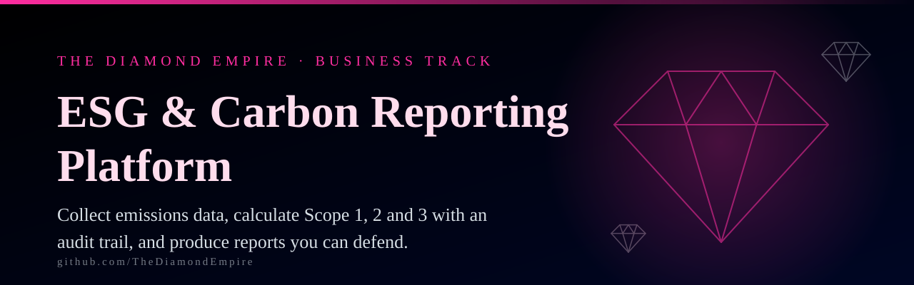
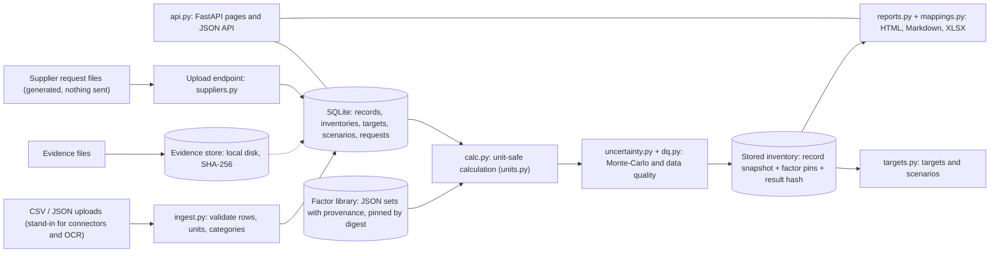

<p align="center"></p>

<p align="center">
  
  
  
</p>

# ESG & Carbon Reporting Platform

> Collect emissions data, calculate Scope 1, 2 and 3 with an audit trail, and produce reports you can defend.

A carbon-accounting engine with a local web interface. It loads activity data from CSV or JSON, converts it to emissions with versioned, sourced emission factors, scores data quality, propagates uncertainty with Monte-Carlo simulation, and keeps an evidence trail behind every number. The emission factors are real U.S. EPA publications recorded with their provenance; everything that was measured about the platform was measured on **synthetic** organizations.

**Quick links:** [Architecture](#architecture) · [Tech stack](#tech-stack) · [Engineering decisions](#engineering-decisions) · [Roadmap](#roadmap) · [Getting started](#getting-started) · [Case study](docs/case-study.md) · [Research report](docs/research-report.md) · [Factor provenance](docs/factor-provenance.md) · [Worked examples](docs/worked-examples.md) · [Results](results/tables.md)

> **Public showcase.** This repository holds the documentation, client case study, research report and measured results for this product. The runnable source code is distributed separately under a license: see [SOURCE-ACCESS.md](SOURCE-ACCESS.md).

> **No compliance claim.** Nothing in this repository, its reports or its framework mappings states or implies that an inventory satisfies any regulation, standard or disclosure framework (CSRD/ESRS, ISSB/IFRS S2, SEC rules, ISO 14064 and so on). The mappings are documentation aids, written from the author's understanding of each framework and **not checked against the framework texts**. Compliance determinations remain with the reporting organization's advisors and assurance providers.

## At a glance

|  |  |
|---|---|
| **Track** | Business · Advanced |
| **Phase** | Beta: all five milestones work, the tests pass and all four experiments have recorded results (on synthetic data). Not used with any real organization. |
| **Primary reader** | Clients and founders |
| **Read next** | [README](README.md) · [Client case study](docs/case-study.md) · [Research report](docs/research-report.md) |

## Why this exists

Sustainability reporting is assembled in spreadsheets under deadline pressure. Numbers cannot be traced to evidence, emission factors are copied from unknown sources, and every new reporting framework means starting over.

## What it does (built and tested)

- **Activity-data model and import.** CSV or JSON uploads, validated row by row (units, categories, activity types, evidence references); all-or-nothing import; a CSV template. Records carry a facility, region, source type, five data-quality indicators and evidence ids.
- **Evidence store.** Files stored on the local disk, content-addressed by SHA-256 and linked to organizations; every report and trail page can re-check that the stored bytes still match the hash recorded at upload.
- **Versioned emission-factor library.** Four JSON sets (see below), each factor with its exact published value, unit, source document, edition year, publication date, URL, table and cell locator, retrieval date, licence and source-file digest. Inventories pin factor sets by file digest; regenerating after a factor file changed fails loudly.
- **Unit-safe calculation.** Quantities carry units; `kWh + MWh` raises, `gallon` to `kWh` raises, and conversions are explicit steps in the trail (built on `pint` with custom units for mmBtu, scf, passenger-mile and so on).
- **Scope 1:** stationary combustion, mobile combustion (CO2 only), fugitive refrigerant releases. Biogenic CO2 is reported outside the scope totals.
- **Scope 2:** location-based (eGRID subregion rates) and market-based (organization-supplied contractual-instrument rates; uncovered electricity falls back to the location factor and is flagged), plus purchased steam and heat.
- **Scope 3:** categories 1 (spend-based), 4, 5, 6 and 7 (activity-based and spend-based where factors exist), plus the supplier-specific method for supplier-reported intensities.
- **Uncertainty and data quality.** Monte-Carlo with documented distributions (lognormal default; normal, uniform and triangular available), shared factor draws across lines, common random numbers; five-indicator data-quality grades A to E; "where better data would reduce uncertainty most" ranking.
- **Inventory reports.** HTML, Markdown and XLSX generated from a stored inventory (never recomputed), with the evidence trail, factor appendix, method notes and framework mapping aids.
- **Targets and scenarios.** Absolute reduction targets on a straight-line path with progress as reported and like-for-like after a factor edition change; what-if scenarios (scale activity, set a contractual instrument, swap an activity type) with before/after ranges on common random numbers.
- **Supplier data requests (stand-in).** Generated request CSV files and an upload endpoint for the reply; **nothing is sent**.
- **Web interface and JSON API.** Server-rendered pages with semantic HTML, labelled forms, table captions, a skip link, visible focus and light/dark themes; no JavaScript required.

## Not built yet / out of scope

| Item | Why |
|---|---|
| Utility-bill OCR | Out of scope for this build; scanned bills can only be stored as evidence. CSV and JSON are the supported inputs. |
| Live connectors, supplier portals, email | Stand-ins by design: supplier requests are files you hand over yourself. |
| Object storage, PostgreSQL, Docker, Terraform | Replaced by the local filesystem and SQLite so everything runs from one command with no daemon. |
| Scope 3 categories 2, 3, 8 to 15 | No sourced factors in the library for them (category 3 needs upstream fuel and grid-loss factors). |
| Non-US factors, residual-mix factors | Only U.S. EPA publications were retrieved and verified. UK DESNZ factors were not retrieved. |
| Mobile CH4 and N2O | The Hub's per-vehicle-mile tables are not in the library; mobile combustion is CO2 only. |
| Base-year recalculation policy, organizational-boundary modelling | Not designed; targets compare stored inventories only. |
| Authentication, CSRF protection, multi-user roles | Single-user local prototype. Do not expose it on a network. |
| PDF report export | Print the HTML report from a browser. |
| Verification of the framework mappings against the framework texts | Not done; every mapping row says "unverified". |
| Real-organization validation | Everything measured used synthetic organizations. |

## Architecture



## Tech stack

| Layer | Technology |
|---|---|
| App | Python 3.12, FastAPI, Jinja2 server-rendered pages (plain CSS, no JavaScript framework) |
| Calculation | Python with `pint` units and a strict unit layer; `numpy` and `scipy` for Monte-Carlo and statistics |
| Data | SQLite (standard library `sqlite3`); local-filesystem evidence store |
| Ingestion | CSV and JSON files, validated in `ingest.py` |
| Reporting | Jinja2 (HTML), Markdown, `openpyxl` (XLSX) |
| Quality | `pytest`, `hypothesis`, `mypy --strict`, `ruff`; GitHub Actions workflow written but **not executed** (the repository has never been pushed anywhere) |
| Packaging | `uv`, `pyproject.toml`, `uv.lock` |

## Engineering decisions

### Every number is reproducible

A stored inventory keeps a snapshot of its activity records, the SHA-256 digests of the factor files it used, the seed and the Monte-Carlo size. `esg verify` (or the Verify link) regenerates it and compares result hashes; the regression test regenerates a frozen 2024 inventory and its full Markdown report and asserts they are identical, and shows that a changed factor file is rejected rather than silently re-used.

### Uncertainty is reported, not hidden

Totals come with 5th to 95th percentile ranges, data-quality grades and a ranking of the inputs whose improvement would reduce the range most. The distributions and spreads are **assumptions** and are labelled that way in every record and report; the research report measures what happens when they are wrong.

### Factors are data, with provenance

Emission factors live in versioned JSON sets with their source, edition, locator and licence. Nothing was typed from memory: a tool reads the published EPA workbooks and CSV and records the cell addresses. Where a real factor could not be sourced, the library holds clearly named `TEST_` factors in a separate synthetic set; they are labelled in every page and report and are never presented as real. See [factor provenance](docs/factor-provenance.md).

### Honest about what the experiments are

Spend-based versus activity-based results depend on the synthetic generator's price assumptions, calibration was checked against truth the same author defined, and the correctness examples were hand-derived by the author. The research report says this in each place it matters.

## Results at a glance

Synthetic organizations only; protocol v0.2; one uninterrupted run (93 work units, about 4.3 minutes of wall clock on a heavily loaded shared machine). Details, tables, caveats and the change log are in the [research report](docs/research-report.md); raw results are in `results/`.

| Experiment | Headline | Verdict |
|---|---|---|
| E1 method comparison | At assumed prices, spend-based differs from activity-based by more than 30% (median) in 2 of 4 categories; the sourced factors imply breakeven prices of 0.32 USD per short ton-mile (truck), 0.045 (rail), 0.20 USD per passenger-mile (air) and 587 USD per short ton (landfill). | H1 supported only at the boundary; it depends on the generator's price assumptions and says nothing about real-world differences. |
| E2 uncertainty calibration | Nominal 90% interval covered the truth in 89.5% of 1,000 organizations (95% CI 87.4% to 91.3%) when the generator matches the engine's assumptions; 1.0% under a systematic 20% under-reporting bias; 58.5% when true factor errors are twice the assumed size. | H2 supported for the well-specified case; intervals are not robust to wrong assumptions or to bias. |
| E3 where to improve data | Upgrading the top variance contributors cut the 90% interval width by 36.6% (1 input) to 65.5% (5 inputs) versus 2.0% to 9.8% for random inputs; "largest relative uncertainty" was worse than random. | H3 supported inside the model; the gap size is the informative part. |
| E4 correctness | 21 of 21 hand-derived comparisons within tolerance (maximum relative error 4.7e-16); 16 of 16 unit-safety checks passed. | H4 supported (hand-derived, not published, examples). |

## Roadmap

- [x] M1: activity-data model, evidence store and factor library
- [x] M2: Scope 1 and 2 calculations with uncertainty
- [x] M3: Scope 3 (spend-based and activity-based) and data-quality scoring
- [x] M4: inventory reports and framework mappings (aids only)
- [x] M5: targets, scenarios and supplier data requests (stand-in)
- [ ] Next: real-organization validation, non-US factor sets, further Scope 3 categories, base-year recalculation

## Getting started

> _These instructions refer to the source package, which is distributed separately and is not part of this showcase repository._

Requires [uv](https://docs.astral.sh/uv/) (it installs Python 3.12 for you). These are the commands that were run from a clean copy of the repository.

```bash
uv sync                      # create the virtual environment from uv.lock
uv run esg init              # create the SQLite database in the gitignored data/ folder
uv run esg demo              # load the SYNTHETIC demo organization (two inventories, a target, a supplier request)
uv run esg serve             # web app at http://127.0.0.1:8000
```

Then open `http://127.0.0.1:8000`, choose the demo organization, open an inventory and select a record to see its evidence trail. Other commands:

```bash
uv run esg factors           # list the factor sets in the library
uv run esg verify 1          # regenerate inventory 1 from its snapshot and compare hashes
uv run esg report 2          # write inventory 2 as .md, .html and .xlsx into data/reports/
```

To load your own data, download the CSV template from the organization page (or use `examples/activity_example.csv` as a starting point), then upload it. Valid activity types and units are listed in the factor library page.

Run the experiments (resumable; at most 2 worker processes):

```bash
uv run python -m experiments.run_all           # all four experiments, writes results/
uv run python -m experiments.e2                # or one experiment
uv run python -m experiments.run_all --smoke   # tiny sizes for a quick check, writes to .tmp/
```

Configuration (all optional) is in `.env.example`: `ESG_DATA_DIR` and `ESG_FACTOR_DIR`. Runtime data lives in `data/` (gitignored) and is re-created by the commands above. The app makes no network calls; the one tool that downloads (`tools/build_factor_library.py --fetch`) uses `curl`. On Windows, if a Python process that makes HTTPS requests crashes, clear the `SSLKEYLOGFILE` environment variable first; the platform itself does not need this.

## Verification

> _These instructions refer to the source package, which is distributed separately and is not part of this showcase repository._

```bash
uv run ruff check .
uv run ruff format --check .
uv run mypy
uv run pytest
uv run python -m tools.check_repo     # no absolute paths, user names or unresolved placeholders in any file
```

Last verified on a clean copy of the repository placed at a short path (the Windows path-length limit can break native packages in deep folders): `uv sync --locked`, then the five commands above, then the app and CLI commands from Getting started and the smoke experiment run. Results: ruff, format check, mypy (48 source files, strict) and the hygiene scan clean, **128 tests passed** (about 3 minutes on a heavily loaded shared machine; most of that is worker-process start-up in the runner tests). The GitHub Actions workflow runs the same commands but has not been executed.

The test suite covers unit safety, hand-derived worked examples, factor-library provenance and drift detection, uncertainty propagation against known distributions (known intervals and moments), property-based tests (`hypothesis`), regeneration of a frozen historical inventory and report, import validation, evidence integrity, the web pages and API, targets, scenarios, supplier requests, and the experiment runner's resume and crash-recovery behaviour. The factor files can be re-extracted and compared with `uv run python -m tools.build_factor_library --fetch --verify` (needs network and `curl`).

## Repository layout

> _These instructions refer to the source package, which is distributed separately and is not part of this showcase repository._

```
src/esg/            engine and app: units, factors, calc, uncertainty, dq, inventory, reports, mappings,
                    targets, suppliers, ingest, evidence, db, service, api, cli, demo, templates/, static/
factors/            the emission-factor library (checked in): epa_hub_2025, epa_hub_2024, useeio_v1_3, test_factors
experiments/        E1 to E4, synthetic generator, hand-derived cases, resumable runner
results/            raw per-unit results, summary.json, tables.md, run_metadata.json
tests/              unit, property, regression (tests/golden/), API and runner tests
tools/              factor extraction, golden fixtures, repository hygiene scan, worked-examples doc generator
examples/           a small example CSV
docs/               research report, case study, factor provenance, worked examples
data/               runtime data (gitignored; re-created by `uv run esg init` and `uv run esg demo`)
```

## Skills demonstrated

`Calculation-engine design` · `Uncertainty quantification` · `Data provenance and audit trails` · `Sustainability domain modelling` · `Report generation` · `Unit-safe numerical code`

## One project, three lenses

The same project is documented for three audiences, so one body of work serves every goal.

| If you are… | Read | You will find |
|---|---|---|
| Hiring or reviewing engineers | [This README](README.md) | Architecture, trade-offs, quality bar and what I would defend in a design review |
| A client or founder | [Client case study](docs/case-study.md) | The business problem, the value levers, how it is measured and how an engagement runs |
| A researcher or technical reviewer | [Research report](docs/research-report.md) | Hypotheses, methods, statistical plan, results with confidence intervals, threats to validity and the reproducibility checklist |

## Author

Built by **[The Diamond Empire](https://thedempire.shop/)**.
