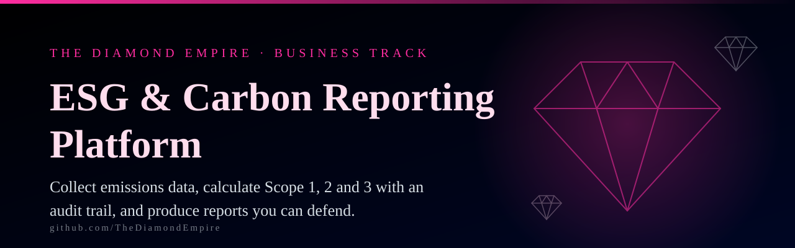

# ESG & Carbon Reporting Platform: Client Case Study

> Faster, defensible emissions reporting that holds up to scrutiny.

> **Status of this document.** This is a reference case study: it sets out the business problem, the solution and the value model. The results table is intentionally blank and is filled in only from measured data (a pilot or a real engagement). No outcome figures are claimed here. The product described below is a working prototype built and tested on synthetic data only; it has not been used in a client engagement.

## Snapshot

|  |  |
|---|---|
| **Who it is for** | Mid-size companies and their suppliers that must report emissions to customers, lenders or regulators. |
| **Solution** | Collect emissions data, calculate Scope 1, 2 and 3 with an audit trail, and produce reports you can defend. |
| **Track** | Business · Advanced |
| **Delivered by** | The Diamond Empire |

## The challenge

Collecting data takes months, the final inventory cannot be traced to evidence, and customers keep sending new supplier questionnaires that each require manual answers.

## The solution

A carbon-accounting and sustainability-reporting platform that gathers activity data from fuel, utility, travel, waste and procurement records, converts it to emissions with versioned and sourced factors, scores data quality and uncertainty, and keeps an evidence trail behind every number.

What the client gets in practice (what exists today):

- Activity data loaded from CSV or JSON files (fuel, utilities, freight, waste, travel, commuting, spend), validated row by row, with scanned bills and invoices attachable as hashed evidence files. Reading scanned bills (OCR) is not built.
- Versioned emission-factor library with source, edition year, URL, locator, retrieval date and licence recorded for each factor; the shipped sets are U.S. EPA publications (US factors only)
- Calculation engine for Scope 1, Scope 2 (location- and market-based) and Scope 3 categories 1, 4, 5, 6 and 7, activity-based and spend-based
- Data-quality scoring and Monte-Carlo uncertainty, with ranges instead of false precision, and a ranking of where better data would reduce uncertainty most
- Evidence trail: every reported number links to its input record, the exact factor and arithmetic, and the evidence files, with an integrity check
- Inventory reports (HTML, Markdown, XLSX) with framework mapping aids, targets and what-if scenarios, and generated supplier data request files (nothing is sent; the reply is uploaded)

## How it creates value

| Value lever | How the solution delivers it | How we measure it |
|---|---|---|
| Reporting effort | Structured imports and automated calculation replace spreadsheet assembly | Staff-days per reporting cycle |
| Credibility | Evidence trail and uncertainty scoring stand up to assurance | Assurance findings; adjustments after review |
| Data quality over time | Quality scores show where to improve measurement | Share of emissions from high-quality data |
| Customer and lender requirements | Reusable inventory outputs and evidence support questionnaire answers | Hours per questionnaire; requests answered on time |
| Reduction planning | Hotspots, targets and scenarios guide investments | Projected vs. realized reductions |

## How an engagement runs

| Phase | What happens |
|---|---|
| Scope | Boundaries, categories and reporting obligations, agreed with the client's advisors |
| Collect | Data files collected and validated against the import template (live connectors would be scoped per engagement; none are built) |
| Calculate | First inventory with quality and uncertainty review |
| Report | Inventory reports with framework mapping aids, and an improvement plan |

## What the client receives

- Configured platform with the client's organizational data
- Import templates and validation rules for the client's data files
- First full inventory with evidence trail
- Inventory reports (HTML, Markdown, XLSX) with mapping aids for the frameworks the client's advisors name
- Training for sustainability and finance teams

The framework mappings are documentation aids. They do not state that any regulation or disclosure framework is satisfied; that determination stays with the client's advisors and assurance providers.

## Results

Baseline measurements are taken **before** the solution goes live, and the same measures are taken after, so every change in the table is attributable and honest.

| Measure | How measured | Baseline | After | Change |
|---|---|---|---|---|
| Reporting effort | Staff-days per reporting cycle | — | — | — |
| Credibility | Assurance findings; adjustments after review | — | — | — |
| Data quality over time | Share of emissions from high-quality data | — | — | — |
| Customer and lender requirements | Hours per questionnaire; requests answered on time | — | — | — |
| Reduction planning | Projected vs. realized reductions | — | — | — |

> **To fill in:** replace each — with measured values and add the measurement window and sample size beneath the table.

## How quality and risk are managed

- Calculation engine tested against hand-derived worked examples (arithmetic shown in the repository), not against published reference datasets
- Unit-safety: all arithmetic is unit-aware, so mixing kWh with MWh fails loudly
- Regression tests that regenerate a historical report from its stored snapshot and pinned factor versions and assert identical results
- Uncertainty ranges rest on assumed distributions, labelled as assumptions; calibration was measured on synthetic data only (see the research report)
- Compliance determinations stay with the client’s advisors: framework mappings are documented as aids

## Is this a fit?

Best suited to: mid-size companies and their suppliers that must report emissions to customers, lenders or regulators. The emission factors shipped today are United States factors; an engagement outside the US would need a different, citable factor source added to the library.

## Talk to me

Want this adapted to your business? Get in touch via **[thedempire.shop](https://thedempire.shop/)**.

---

[README](../README.md) · [Client case study](case-study.md) · [Research report](research-report.md)
